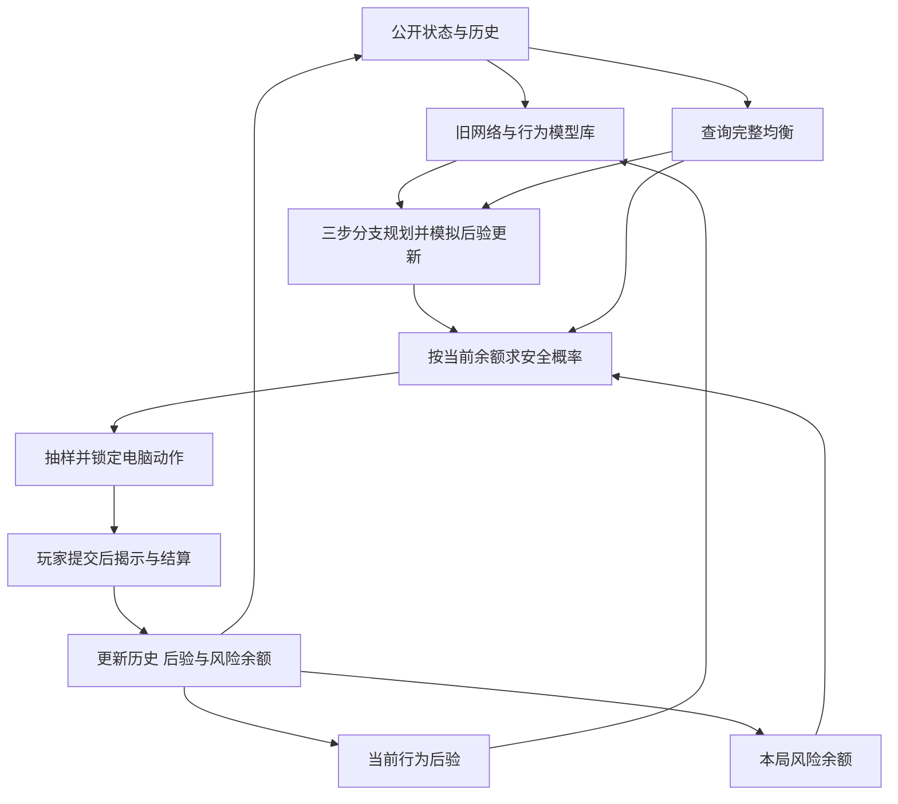

# 西部牛仔电脑策略建模报告：完整一局与快速一轮

更新日期：2026-10-27。本文覆盖原报告，保留文件名以兼容已有链接，同时说明快速一轮与完整一局。先解释思路，再给出关键公式、实验依据和代码入口，不展开论文式证明。

版本依据：准备发布的 **v0.17.0**，完整模式策略为 `full-temporal3-belief005-recent10-v1`。它在 v0.16 的固定遗忘后验上增加初始占比 10% 的动态近期动作层；均衡、网络权重、三步规划和风险上界不变。研究依据包含本地第六至第二十一阶段记录。

当前完整 AI 可以理解为：**规则和均衡负责计算底线，神经网络与行为假设负责判断玩家，公开动作负责修正判断，三步规划负责选择应对，风险余额负责限制冒险。** 它没有靠网络直接输出一个不受检查的动作，也没有求出针对任意真人的全局最优策略。

## 1. 当前网页实际使用什么模型

两种模式都遵循“先估计玩家会怎样行动，再选择有利的应对”的思路，但采用不同实现。完整模式必须联合考虑选弹、筹码结算和剩余轮数，不能简单重复快速模式的轮内策略。

| 项目 | 快速一轮 | 完整一局 |
| --- | --- | --- |
| 任务 | 从双方零子弹开始，赢下这一轮 | 从双方 50 筹码开始，在最多五轮后赢下整局 |
| 基础模型 | 单轮均衡表、折扣最佳响应 | 完整规则下的有限时域均衡 |
| 玩家预测 | 历史频次、均衡先验、上一回合条件统计 | 原小型行为网络、814 个贝叶斯行为假设，以及动态近期动作层 |
| 决策 | 普通最佳响应混合；有优势时升级为记忆一回合的最佳响应 | 三步分支中模拟学习，按动态整局风险余额优化概率 |
| 当前局内适应 | 切换上一回合动作上下文；不重新统计当前局样本 | 每次揭示后更新历史与后验，并回补 0.5% 先验；下次立即使用 |
| 跨局学习 | 下一局从最近完成日志重建模型 | 保留最近 64 条事件、行为后验和累计出招计数；网络权重固定 |
| 随机性 | 按最终混合分布抽样，部分局面为纯动作 | 按安全优化所得分布抽样，当前熵温度为 0 |
| 风险控制 | 经验阈值与均衡混合，没有整轮 0.02 保证 | 相对完整均衡的整局最坏期望得分损失上界小于 0.02 |
| 运行位置 | 浏览器 | 服务端 AI worker，浏览器提交操作与显示结果 |
| 神经网络状态 | 做过研究，尚未替换网页策略 | 旧网络作为模型库的一名预测专家；新 GRU 未上线 |

这里的“学习”不等于重新训练网络。快速模式更新历史统计；完整模式既更新网络输入，也根据玩家的公开行为调整各假设的概率。网络内部参数固定，但电脑对“这个玩家更像哪种打法”的判断逐次变化。

## 2. 游戏规则、目标与记号

令电脑为 C、玩家为 H；当前子弹为 `bc、bh`，筹码为 `mc、mh`，本轮初始选弹为 `pc、ph`。动作编号统一为：0 开枪、1 防御、2 装弹。无子弹时不能开枪，达到子弹上限 10 时不能装弹。

共享规则按以下次序判定：

1. 开枪对装弹触发瞬间胜负，优先于通常的子弹更新与胜负判定。
2. 其余情况中，开枪消耗一发，装弹增加一发；双方同时到 10 为平局，一方至少 5 发且严格多于另一方时获胜。
3. 第 100 回合先按上述规则判胜负，仍未结束才判平局。

研究实验统一报告：

\[
U=\begin{cases}1&电脑胜\\0.5&平局\\0&电脑负\end{cases},
\qquad \mathbb E[U]=P(胜)+0.5P(平).
\]

**平均得分不是纯胜率。** 本文实验胜率以全部对局为分母；网页菜单采用的胜／（胜＋负）统计口径也不能直接与本文平均得分比较。

完整模式直接以整局终局得分为目标。快速模式的实际规划含折扣因子 0.999，因此其价值不是严格的第 100 回合有限时域胜率；具体区别见下一节。

## 3. 快速一轮：统计预测与记忆最佳响应

实现入口：[public/js/ai.js](public/js/ai.js)、[public/js/mode-ai.js](public/js/mode-ai.js)。旧接口中 `b1` 表示玩家、`b2` 表示电脑，与本报告的 C/H 顺序不同。

### 3.1 状态与基础均衡

普通模型只记录双方当前子弹，共 30 个非终局子弹状态。记忆模型再加入上一回合双方动作对，包含“开局”及 9 种动作对，共 300 个增广状态：

\[
s_{quick}=(b_H,b_C),\qquad \widetilde s_{quick}=(b_H,b_C,m).
\]

基础策略来自 [public/strategies.js](public/strategies.js) 中的电脑均衡、玩家均衡和价值表。最佳响应采用平稳折扣模型，折扣因子为 \(\gamma=0.999\)。

这意味着网页规则虽然会在第 100 回合结束游戏，但当前快速 AI 没有把“还剩几回合”放入决策状态，不能称为严格按 100 回合倒推求解。它是已经过实际代码与实验检验的近似策略。

### 3.2 从哪些历史学习

只读取正常完成的快速模式日志，不混入完整模式数据。最多保留最近 90 局，最新一局权重为 1，向前第 k 局权重为：

\[
w_k=0.95^k.
\]

约相隔 13.5 局后，旧局的权重减半。模型按双方子弹差和玩家是否有子弹合并统计：子弹差分为不大于 −3、−2、−1、0、1、2、不小于 3 七档。这样可在相似局面间共享样本，避免每个精确状态都重新积累数据。

代码还使用一项经验性随机检测：某状态有效样本量至少 20，且玩家经验动作分布与合法动作均匀分布的 Jensen–Shannon 散度小于 0.03 时，把这部分统计权重乘以 0.3。这只是降低近似均匀行为的影响，不能证明玩家“真的随机”，也不是对均衡打法的检验。

### 3.3 玩家动作概率

对合法玩家动作 b，先验伪计数为：

\[
\alpha_b=5q_{eq,H}(b\mid s)+1.
\]

将加权历史频次 \(n_b\) 与先验合并：

\[
q_0(b\mid s)=\frac{n_b+\alpha_b}{W+\sum_{b'}\alpha_{b'}},
\qquad W=\sum_b n_b.
\]

均衡先验缓解少样本误判，额外的 1 防止合法动作被赋予零概率。没有历史时，这个平滑预测未必恰好等于玩家均衡分布，但最终电脑行动仍回到电脑均衡策略。

### 3.4 普通最佳响应与均衡混合

把玩家暂时视为按 \(q_0\) 行动，通过价值迭代求电脑最佳响应：

\[
Q(s,a)=\sum_b q_0(b\mid s)
\begin{cases}
U,&本轮结束,\\
\gamma V(s'),&继续游戏.
\end{cases}
\]

迭代最多 20,000 次，最大价值变化小于 \(10^{-7}\) 时提前结束。同时评估电脑坚持基础均衡、面对同一玩家模型的价值。

只有预测的最佳响应优势大于 0.05，才启用利用权重：

\[
\lambda=\frac{W}{W+10},\qquad
p_{base}=(1-\lambda)p_{eq,C}+\lambda\,\mathbf1_{a=a_{BR}}.
\]

优势不足时令 \(\lambda=0\)。样本越多，模型越愿意利用观察到的偏好。这是经验性的信任程度控制，不是严格置信区间。

### 3.5 上一回合记忆与升级机制

为识别“看到电脑上次开枪就防御”等行为，模型估计上一动作对 m 条件下的玩家分布：

\[
q_m(b\mid s,m)=\frac{n_{m,b}+3q_0(b\mid s)}{W_m+3}.
\]

样本少时回退到普通预测；样本增加后，具体反应模式占更大比重。在 300 个增广状态上用策略迭代求解，固定策略的评估通过线性系统：

\[
(I-\gamma P)V=r.
\]

若相关普通统计桶有有效数据，且记忆最佳响应的预测价值比“普通混合策略在同一记忆玩家模型下的价值”高出 0.02，便升级为记忆最佳响应；否则保留普通混合策略。

这里比较的基准是普通混合策略，不是纯均衡。升级后可能采用纯动作，并非始终保留固定比例的均衡随机性。阈值 0.02 表示预测收益门槛，**不代表完整模式使用的 0.02 最坏损失保证**。

### 3.6 何时更新、有哪些边界

每局开始都会重新读取完成日志、构建玩家模型和策略，已修复“必须刷新网页，新日志才生效”的问题。同一局内不会不断把新动作加入统计量或重求整套策略，但会根据最新上一回合动作对切换增广状态，因此能立即采取预先算好的条件应对。

当前电脑动作先抽样并锁定，再等待玩家选择；下一次决策才使用已揭示动作。当前快速模式既没有在线神经网络训练，也没有执行研究目录中的神经候选代码。

主要局限是：对刚刚改变风格的玩家，频次模型要等下一局重建才吸收本局新样本；纯最佳响应也可能被专门反制。它的优势是实现小、决策快，并且在现有普通合成对手上表现较强。

## 4. 完整一局：行为信念、三步规划与动态风险余额

发布策略：`full-temporal3-belief005-recent10-v1`。实际网页 worker 显式选择 `belief`；旧 `credit` 与 `static` 入口仍供历史对照使用，不能用这些默认或旧入口代表网页行为。

### 4.1 状态与终局目标

完整规则状态为：

\[
s=(阶段,轮数,轮内回合数,m_C,m_H,p_C,p_H,b_C,b_H).
\]

玩家预测还使用上一回合动作对、上一轮结果及公开事件历史。筹码保留双方绝对值，不能只保留差额，因为筹码归零会提前结束整局。

完整模型采用折扣因子 1，只在整局结束时返回胜 1、平 0.5、负 0；没有把轮胜、装弹数或筹码差另行加权为奖励。一轮结束后先结算，再进入下一轮选弹。初始选弹与轮内出招都是同时行动，预测器不能读取玩家本次未公开的选择。

### 4.2 赔付为什么会改变轮内风格

双方初始各 50 筹码，每轮选弹范围 0～2，最多五轮。设轮末结算子弹差绝对值为 x，则基础转移额：

\[
y=(p_C+1)(p_H+1)x.
\]

- x 为 0 时不转移筹码。
- 获胜方结算子弹更多时，转移 y；获胜方结算子弹更少时，转移 2y。
- 平局时双方各扣除自己初始选弹数的 5 倍。
- 结算后任一方筹码不大于 0，或第五轮结束，按双方筹码比较整局结果；筹码不会先截断为零。

“劣势双倍”指获胜方的**结算子弹较少**，不是筹码较少。瞬间胜负也要计算结算子弹：开枪方扣一发，被击中的装弹方不增加子弹。

例如第五轮电脑 20 筹码、玩家 80 筹码，双方初始选弹均为 1；当前子弹为电脑 1、玩家 4。若电脑开枪、玩家装弹，结算子弹为 0 和 4，基础赔付为 16，劣势获胜翻倍转移 32，电脑以 52∶48 赢下整局。这个例子说明低子弹获胜也可能很有价值，并不表示电脑能保证玩家配合。

相同当前子弹下，初始选弹决定倍率、当前筹码决定翻盘或提前结束门槛、剩余轮数决定是否还有追赶机会，三者共同改变行动价值。

### 4.3 完整均衡提供可靠的延续价值

离线按有限时域动态规划求解可达状态。终局返回 U，轮末接结算后的下一轮价值，普通出招接下一回合价值。在每个状态构造至多 3×3 的零和矩阵：

\[
Q_{eq}(s,a,b)=
\begin{cases}
U,&整局结束,\\
V_{eq}(s'),&否则,
\end{cases}
\quad
V_{eq}(s)=\max_p\min_b\sum_a p_aQ_{eq}(s,a,b).
\]

先用线性规划建立参照，再用验证过的小矩阵批量求解加速；大型结果存放为磁盘数组，运行时查询和缓存。表文件约 402 MiB，放在服务端，不发送给浏览器。

这套表涵盖完整选弹、结算和回合上限，独立于快速模式旧表。当前记录的累计均衡误差上界为 \(3.868572129306358\times10^{-12}\)，小于最初验收要求的 0.0001。

### 4.4 小型神经网络只预测玩家行为

网络结构：

\[
203\text{ 维输入}\rightarrow96\text{ 个 tanh 隐藏单元}
\rightarrow3\text{ 个动作 logits}\rightarrow合法动作 softmax.
\]

共 19,875 个参数，float64 原始权重 159,000 字节。选弹阶段预测 0、1、2 发，出招阶段预测开枪、防御、装弹，由阶段特征区分。

| 输入部分 | 维数 | 含义 |
| --- | ---: | --- |
| 当前局面 | 19 | 阶段、轮次、回合、双方绝对筹码、初始与当前子弹、上一轮结果、上一动作对、玩家均衡概率 |
| 最近事件 | 88 | 最近 8 条公开事件，每条 11 维 |
| 延迟条件统计 | 96 | 对前 1～4 步的电脑／玩家动作，统计当前玩家动作的条件频率与样本强度 |
| 合计 | 203 | 当前状态与短期行为信息 |

每条事件包含事件存在标识、是否选弹、双方动作 one-hot、轮末／局末标识和轮结果。最近历史最多 64 条；延迟配对统计不跨越轮次边界，避免把上一轮末尾与下一轮开局误当成连续反应。

网络训练使用合成玩家的公开轨迹及合法替代分支，训练集为 832 位合成玩家、75,057 条观测，验证历史为 208 位、18,563 条观测；训练、调参和测试使用独立种子。没有把模拟数据当作真人日志，也不使用快速模式日志训练完整网络。

神经网络的作用是从例子中拟合难以手写的动作依赖、延迟反应和风格变化。它不负责修改规则、决定胜负目标或绕过安全约束；更低的预测误差也不自动等于更高的整局得分。

### 4.5 814 个行为假设：电脑如何认识当前玩家

旧网络负责从局面和历史中提取行为规律；新增模型库让电脑同时保留几种解释，而不是过早认定玩家只有一种打法。每个假设都输出合法玩家动作的概率，最终预测是它们的加权平均。

| 假设组 | 数量 | 主要描述的行为 |
| --- | ---: | --- |
| 原神经网络 | 1 | 原网络的综合预测，混入 2% 合法均匀概率 |
| 固定习惯 | 27 | 不同初弹、轮内动作偏好与偏好强度 |
| 较长记忆 | 108 | 根据本轮 9～12 次出招前电脑的动作作反应 |
| 公开历史反制 | 3 | 根据电脑已公开的动作频率估计其倾向并反制 |
| 周期性变招 | 675 | 在不同起点、周期改变偏好，并响应电脑上一手 |
| 合计 | 814 | 五组初始各占 20%，组内均分 |

因此不是每个假设都分到 1/814。每组先验质量相同，避免周期变招组因为枚举项多而先天压过其他组。

后四组采用三档强度 \(\rho\in\{0.2,0.35,0.5\}\)。固定偏好类概率的基本形式是：

\[
q_k(b\mid s,H,c)=(1-\rho)q_{eq,H}(b\mid s)
+\rho\left(\frac{0.05}{|B(s)|}+0.95\mathbf1_{b=b_k(s,H,c)}\right).
\]

这里 \(B(s)\) 是玩家合法动作集合，\(b_k\) 是该假设偏好的合法动作，\(c\) 是跨轮、跨局累计的公开出招次数，不计选弹。偏好动作不合法时按实现映射到合法装弹或防御；长记忆假设在本轮历史不足时回到玩家均衡。周期变招的起点枚举 6～10 次出招，周期枚举 8～12 次。这些是用于覆盖一些行为的设计范围，不是电脑已经知道真人的变化时刻。

反制假设稍有不同：用同阶段最近最多 16 条事件和电脑均衡伪计数估计电脑出招频率，再根据均衡动作对价值计算玩家的软反制分布。它只看已公开的历史，不读取电脑本次已经锁定的分布或动作。网络专家的 2% 平滑也只是**玩家预测**的一部分，不是在电脑出招前随意加入 2% 随机动作。

令第 k 个假设的权重为 \(w_k\)，当前玩家预测为：

\[
\widehat q(b\mid s,H,w,c)=\sum_{k=1}^{814}w_kq_k(b\mid s,H,c).
\]

玩家动作 b 公开以后，先按揭示前的似然更新：

\[
\widetilde w_k=\frac{w_kq_k(b\mid s,H,c)}{\sum_jw_jq_j(b\mid s,H,c)}.
\]

直观上，如果“固定爱装弹”假设对这次动作的解释比“根据电脑历史反制”更好，它就获得更多权重。但一次行动不是定论，模型保留概率分布，不直接给玩家贴唯一标签。

### 4.6 固定 0.5% 遗忘：允许玩家改打法

纯粹累计后验可能过于相信过去，玩家换风格后很难纠正。当前版本在**每次选弹或出招揭示后**再执行：

\[
w'_k=0.995\widetilde w_k+0.005w_k^{prior}.
\]

这意味着保留 99.5% 的更新结果，再放回 0.5% 的基础先验。曾被压低的解释重新得到一点机会，后续证据可以把它们扶起来。

它不是“有 0.5% 的概率乱走”，不是“每轮删除 0.5% 日志”，也不是每轮重新训练网络。0.005 是验证集从 \(\{0,0.001,0.005,0.02\}\) 中选择的实用参数；没有把它当成真人真实的换风格概率。轮末和局末不会额外重复学习，下一轮也不另外回补 5%。

这套机制能在已有解释之间重新分配信任，不能创造模型库中完全不存在的规律。库中的行为形式借鉴了合成对手设计，因此它们在已知行为族上的成功不能直接推广成“能识别任何真人”。

v0.17 又加入一个更快但受控的近期层。它统计同阶段最近 24 次公开动作，并用长期预测的两次伪观察平滑；初始只占最终预测的 10%。长期预测为 p、近期预测为 r、近期权重为 g 时：

\[
\widehat q=(1-g)p+gr,\qquad g_0=0.1.
\]

玩家动作 b 公开后，g 按 p(b) 与 r(b) 的似然更新，再以 0.5% 回到 0.1。近期规律连续预测更准才会获得更高权重；失效后也能重新下降。直接让近期统计覆盖长期模型虽然更贴合单人日志，却在合成整局筛选中明显退步，因此没有采用。

### 4.7 三步规划如何利用未来观察

每次最多前瞻三次同时决策，选弹也算一次。搜索中对每个动作对执行真实规则，推进子弹、筹码、轮次和历史；随后在该分支上更新后验、执行同样的 0.5% 回补，并重新预测玩家下一手。各分支有各自的假想判断，不会改变真实会话的后验。

若搜索抵达整局终点，直接使用 U；否则在深度末端使用完整均衡延续价值。概念上：

\[
\widehat Q_d(s,H,w,c,a)=\sum_b\widehat q(b\mid s,H,w,c)
\begin{cases}
U,&整局结束,\\
V_{eq}(s'),&d=1且未结束,\\
\widehat V_{d-1}(s',H',w',c';0),&d>1且未结束.
\end{cases}
\]

这里 H′、w′、c′ 是该分支模拟的新历史、后验与累计出招计数；分号后的 0 表示后续模拟决策不新增风险额度，实际根节点使用本局当前余额。

例如电脑考虑装弹时，会分别模拟玩家的各个合法动作及结果。如果玩家这一手更支持“偏好开枪”或“响应电脑上一手”的解释，该分支下一步便据此调整预测和行动。双方仍然同时行动，玩家预测不能偷看电脑这次尚未公开的随机动作。规划同时考虑局面变化与未来判断变化，没有给“获取信息”另加一份主观奖励。

这是小规模显式分支规划，不是最初设想的 729 参数组合，也不是完整时域的贝叶斯蒙特卡洛树搜索。当前 814 个假设采用了另一套行为结构；后验还带实用遗忘机制。它只在三步内体现未来观察的价值，末端仍使用完整均衡，可能低估之后继续利用玩家弱点的收益。现有实验也没有单独证明每个场景都因预见学习而获益。

### 4.8 动态整局风险余额与行动随机性

每个新整局从风险余额 \(R_0=0.0199\) 开始。给定搜索得分，当前发布版求解：

\[
\max_p\sum_a p_a\widehat Q_a,
\quad p_a\ge0,\quad\sum_ap_a=1,
\]

并对每个合法玩家动作 b 要求：

\[
\sum_a p_aQ_{eq}(s,a,b)\ge V_{eq}(s)-R.
\]

它会在约束允许的范围内利用玩家弱点。当前温度为 0，没有额外熵奖励；最终仍从所得分布抽样，所以“温度为 0”不等于每次必然采用纯动作。若想增加随机性，需要在同一可行域内重新比较，不能在抽样前随意混入固定比例随机动作。

玩家动作 b 揭示后，余额更新为：

\[
R'=\max\left(0,\ R+\sum_a p_aQ_{eq}(s,a,b)-V_{eq}(s)\right).
\]

记账依据整个已锁定概率分布，而不是电脑这次恰好抽中的动作。玩家的可利用选择可能增加余额，冒险利用可能消耗余额；余额可超过初始值，换轮不重置，新整局才重置。

早期固定限额版每一步最多损失 \(0.0199/505\)，容易把可利用空间压得太小。v0.15 起采用的动态余额允许跨轮累计和使用，v0.16 继续保留；三步搜索中的后续节点仍按零新增风险求解，没有采用更复杂的未来余额分支规划。

最多五次选弹加 500 次出招，计入每次 \(10^{-10}\) 数值余量与均衡误差：

\[
0.0199+505\times10^{-10}+3.868572129306358\times10^{-12}
=0.019900050503868574<0.02.
\]

这个上界约束的是**相对完整均衡的整局最坏期望得分损失**，不是每局最多输 2% 筹码，也不是保证比针对每位弱玩家的理想最佳响应只差 0.02。具体收益仍取决于玩家预测与搜索质量。

### 4.9 学习生命周期、时限和失败回退

真实动作只在公开后加入历史，并按揭示前的预测更新一次后验。换轮重置当前轮的上一动作上下文，保留上一轮结果、公开历史、后验与累计出招计数；长延迟检索仍不能跨轮。跨局保留学习结果，但新局状态回到初始状态，风险余额重新从 0.0199 开始。

当前浏览器保存最近 64 条事件及 814 个后验概率等记忆。后验压缩保留了更早的证据，因此“最多 64 条原始事件”不等于只受最近 64 步影响。旧格式升级会保留公开历史，新增后验从基础先验开始，不伪造过去的贝叶斯学习过程。不同会话独立；不与快速模式混用，不跨设备自动同步。

**没有按局数、日期或胜率自动触发的神经网络重训练。** 当前逐步变化的是后验与历史。原网络权重固定，只有另行生成数据、离线训练、独立评测并发布新的权重，网络参数才会改变。完整模式的操作和恢复记忆会发送到服务端参与计算，但没有启用自动上传诊断和集中在线训练。

余额由服务端会话维护，客户端不能自行增加；重复请求不得重复学习或重复记账。恢复历史记忆并不恢复一场旧残局：新会话从新整局开始，避免用新余额接着玩旧状态。无完整模式历史时，实际行动采用完整均衡。

决策采用约 2.5 秒的软预算和最多 20,000 个搜索节点，先完成较便宜的安全决策，再尝试完整三步规划。预算耗尽时使用已经完成的保底结果；预测无效时回退到均衡；概率优化结果须通过数值安全检查。单次正在执行的计算与文件读取不能被预算立即打断，因此这是尽力遵守的时限，不是严格实时保证。

## 5. 实验结果与取舍

以下均为既有离线实验，不是本文整理时重新进行的真人测试。不同阶段使用的对手与控制器不同，不能把跨阶段分数直接拼成连续进步曲线。置信区间反映对应合成样本的差异，不代表真人总体。

### 5.1 快速模式：网络有局部收益，但尚不足以替换原版

第一轮独立测试中，小网络候选平均得分 0.7912，原版 0.7635，配对差值 0.02770，参考 95% 区间为 [0.00758, 0.04759]。不过固定偏好类型退步，第三局的得分也未超过原版。见首轮结果（本地研究文件：`research/quick_ai/results/REPORT.md`）。

后续加入更严格风险控制、统计与网络组合、未来余额规划。在最后一轮规划实验中，14 类对手、每类 64 位玩家、每人 12 局、四种控制器，共 43,008 局。11 类普通对手上的结果为：

| 策略 | 平均得分 |
| --- | ---: |
| 网页原版 legacy | 0.8719 |
| 动态余额、两步、后续零新增风险 | 0.8214 |
| 动态余额、三步、后续零新增风险 | 0.8209 |
| 三步未来余额规划候选 | 0.8394 |

未来余额规划比旧两步安全候选提高 0.0180，95% 区间 [0.0125, 0.0236]，但仍比网页原版低 0.0326，区间 [−0.0425, −0.0227]。另一方面，专门反制压力组中，原版得分约 0.0872，未来余额候选约 0.4909。该反制者知道电脑概率分布但不知道抽中的动作，不等同于普通真人，也不等同于整轮精确最佳响应。

**当前取舍是保留快速模式原版。** 这不是断言神经网络没有用，而是候选的普通对手收益与反制风险尚未形成更合适的折中；这些候选也同时改变了规划和风险机制，不能把全部差异归因于预测器。详见最终规划实验（本地研究文件：`research/quick_ai/results/PLANNING.md`）。

### 5.2 完整模式：动态余额是已采用的主要改进

第六阶段在 10 类对手、每类 64 位合成玩家、每人连续两局、三个策略上共运行 3,840 局。保持网络不变，比较固定逐步预算、动态余额和未来余额规划：

| 对手范围 | 原固定逐步预算 | 已采用的动态余额 | 未采用的未来余额规划 |
| --- | ---: | ---: | ---: |
| 8 类普通对手平均得分 | 80.71% | 93.16% | 93.70% |
| 2 类压力对手平均得分 | 53.52% | 60.74% | 63.48% |

普通对手上，动态余额比固定预算高 12.45 个百分点，95% 区间 [9.72, 15.04]；未来余额规划比动态余额只高 0.54 个百分点，区间 [−0.73, 1.90]，尚不能确认额外收益。

动态余额在普通组的胜率为 92.68%、平局率 0.98%、负率 6.35%（四舍五入可能使合计略偏离 100%）。这组结果支持采用简单动态余额，但不是“真人胜率 93%”的证明。

两版也改变了模拟后续节点的风险处理，因此不是只改一个预算数字的严格单因素实验。该实验本地平均决策约 2.08 ms、P95 约 3.20 ms；抽样状态在 0.5、1、2.5 秒预算下均完成相同决策。它说明当前三步搜索在测试电脑上足够轻，不保证 Render 的冷启动、并发、网络延迟或手机端运行时间。详见动态余额实验（本地研究文件：`research/match_ai/phase6/REPORT.md`）。

### 5.3 从神经预测到行为后验：为什么采用当前版

第十六阶段固定原三步规划、均衡末端和风险规则，只比较旧网络、固定模型库先验、会逐步学习的模型库后验。四类困难合成对手的结果为：

| 预测方式 | 整局期望得分 |
| --- | ---: |
| v0.15 原网络 | 67.58% |
| 814 个假设、固定先验 | 72.56% |
| 814 个假设、公开观察后更新后验 | 77.10% |

后验相对固定先验提高 4.54 个百分点，玩家配对 95% 区间为 [1.32, 7.71]；相对原网络提高 9.52 个百分点，区间 [5.91, 13.33]。这说明在本次已知行为族上，观察后的学习有额外价值，收益不只是模型库先验本来更适合这些对手。该阶段共 4,704 局，包含另外的普通与压力组；上表只对应事先指定的四类困难组。

第十七阶段进一步测试未知延迟、非周期变招、偏好突变和规则切换，共 4,800 局。四类新场景中，旧网络得分 70.61%，无遗忘后验 74.95%，0.5% 固定遗忘版 77.29%。固定遗忘相对旧网络提高 6.69 个百分点，区间 [3.13, 10.16]；相对无遗忘版提高 2.34 个百分点，区间 [−0.34, 4.88]。因此可支持整套候选比旧网页更合适，尚不能说 0.5% 遗忘本身在所有场景都已证实更强。

第十八阶段又尝试“检测变招后加大遗忘”，核心八类得分从固定版 77.00% 到 78.37%，差值区间 [−1.12, 3.81]，额外收益不确定，压力组也有退步信号。本次保留较简单的固定比例，没有把自动遗忘上线。

### 5.4 已实际尝试 GPU 和百万样本，为什么仍保留固定版

第十九阶段已经在本机 RTX 5060 Laptop GPU 上进行 CUDA 训练，不再只是讨论扩大规模。候选采用最近 64 条事件的 GRU(32)，与 215 维公开局势特征结合，再接 64 维隐藏层和三动作输出，共 20,387 个参数。它是新的行为预测器，不是当前网页的 203→96→3 网络。

| 训练规模 | 验证交叉熵，越低越好 | GPU 训练时间 |
| --- | ---: | ---: |
| 10 万条合成样本 | 0.701193 | 5.87 秒 |
| 100 万条合成样本 | 0.644945 | 52.38 秒 |

原网页网络在同一验证集的交叉熵为 0.803055。百万版的预测误差明显更低，但该指标是验证集的动作概率拟合误差，不能替代独立整局比赛。两档训练也做了不同数量的梯度更新，不是只改变数据量的单因素实验。

独立比赛共 3,584 局，主要 15 类行为等权汇总如下：

| 策略 | 期望得分 | 胜率 | 平局率 | 负率 |
| --- | ---: | ---: | ---: | ---: |
| v0.15 旧网页 | 81.77% | 81.35% | 0.83% | 17.81% |
| 固定 0.5% 遗忘，现已上线 | 88.49% | 87.71% | 1.56% | 10.73% |
| 10 万样本 GRU 候选 | 86.41% | 85.94% | 0.94% | 13.13% |
| 100 万样本 GRU 候选 | 86.82% | 85.94% | 1.77% | 12.29% |

百万版相对固定版为 −1.67 个百分点，配对 95% 区间 [−4.11, 0.83]，没有获得替换固定版的提升证据。一个明显短板是“根据电脑公开历史反制”类型：固定版得分 92.19%，百万版 61.72%。该分类结果用于定位问题，不能代表所有人类反制行为。

百万样本生成耗时约 652 秒，训练约 52 秒；当时主要耗时在 CPU 对局模拟与评测。网络在 GPU 上训练，游戏时依然可以用 Node 在 CPU 推理。训练显存峰值约 2.1 GiB，这些结果不支持“没有用足 GPU 就一定还有廉价提升”的判断。

### 5.5 神经融合修复了部分短板，但没有超过固定版

第二十阶段保留固定版的行为专家，让新 GRU 与它合作。验证阶段比较模型库替换与动态融合，选中动态融合后冻结配置，使用新玩家和随机流独立测试。共 224 位合成玩家，每位每种策略连续四局，三个策略共 2,688 局。

| 策略 | 主要 15 类期望得分 | 胜率 | 平局率 | 负率 |
| --- | ---: | ---: | ---: | ---: |
| 固定遗忘 | 86.88% | 86.04% | 1.67% | 12.29% |
| 纯新神经预测 | 84.64% | 83.85% | 1.56% | 14.58% |
| 动态融合 | 86.88% | 86.25% | 1.25% | 12.50% |

这里“纯新神经预测”指玩家预测环节使用新网络，决策仍由规划器和安全约束完成。动态融合相对固定版的得分差为 0，配对 95% 区间 [−1.88, 1.88] 个百分点，未显示总体额外收益。

| 分组期望得分 | 固定遗忘 | 纯新神经 | 动态融合 |
| --- | ---: | ---: | ---: |
| 根据公开历史反制 | 76.56% | 64.06% | 77.34% |
| 两个未训练变体 | 76.56% | 75.00% | 81.25% |
| 三个压力对手 | 48.96% | 50.52% | 47.40% |

融合保留了应对公开历史反制的能力，并在部分新变体上显示希望，但分项进步不等于全面胜出。三个压力对手为均衡、读取当前已承诺分布的一步反制、诱导后反制，它们不并入主要玩家得分；读取当前分布的压力对手与只看公开历史的反制型玩家也不是同一类。

本机串行决策中位数：固定版约 8.78 ms，动态融合约 19.29 ms；P95 分别为 12.34 与 23.65 ms。计时使用各策略自身轨迹上的快照，不是严格同状态的速度排名；也不包含 Render 冷启动、网络和并发开销。本次上线取舍是：**保留得分相当、运行成本较低的固定遗忘版，新 GRU 和融合留在离线研究中。**

### 5.6 其他已尝试的方向与未采用原因

| 方向 | 已有发现 | 当前决定 |
| --- | --- | --- |
| 更深的短程模拟 | 所测候选没有带来可靠整体收益，部分落后局面变差 | 不接入 |
| 在线统计校正网络预测 | 某些预测指标和对手类别改善，但未确认整体得分提升 | 不接入 |
| 显式规划未来风险余额 | 完整模式普通组额外收益区间覆盖零，计算更重 | 保留简单动态余额 |
| 额外熵随机化 | 没有足够整局收益支持替换当前零温度方案 | 保留安全分布抽样 |
| KL 受控概率更新，第十阶段 | 试过限制概率偏离参考均衡的优化；选定候选未确认独立得分提升 | 未上线非零 KL 惩罚 |
| 长期价值网络，第十至十一阶段 | 204→64→1 网络学习零新增风险教师的真实终局得分；校准后仍未确认整局提升，并有压力组退步 | 末端继续用均衡值 |
| 更长原始历史、分支蒸馏，第十二至十五阶段 | 更低平均预测误差没有稳定转成更高整局得分；依赖隐藏信息的准确预测参照显示了改进空间 | 转向可公开学习的行为后验，未上线学生网络 |
| 自动调节遗忘，第十八阶段 | 比固定版平均值略高，区间仍覆盖零 | 固定每次 0.5% |
| 扩大至百万样本 GPU 训练，第十九阶段 | 新网络预测误差降低，但没有超过固定版 | 保留训练产物，不替换网页权重 |
| 动态神经融合，第二十阶段 | 修复部分反制短板，总体未超过固定版 | 暂不增加线上推理成本 |

更强对手的第九阶段实验共 1,536 局：原神经预测与在线校正总体平均得分均为 62.70%，差值区间 [−3.39, 3.39] 个百分点；更接近可学习行为的四类对手上提高 1.56 个百分点，区间 [−2.64, 5.57]，仍不确定。详见独立验证（本地研究文件：`research/match_ai/phase9/REPORT.md`）。

电脑自对战主要用于发现规则、泄漏和安全问题，不能代替真人目标。两个谨慎策略之间的高平局率，不构成强行降低平局奖励或放松安全约束的理由。后续应优先看人类常见偏好、反应、换风格与被适应后的得分。

最初受论文启发提出过受控策略更新、长期价值学习与更强历史表示；我们已把其中若干思想转化成自己的小规模实验。当前发布模型是按本游戏的效果与成本选择的组合，不宣称直接实现或继承论文整套算法与保证。

这些研究报告中的“未部署”描述的是各自实验完成时的状态。当前采用范围以本报告和 [v0.17 发布说明](RELEASE_AI_V0_17.md) 为准；第十六至十七阶段的固定遗忘模型及第二十一阶段筛选出的保守近期层已完成生产移植，其余研究代码不因同处仓库就自动成为网页功能。

### 5.7 规则、移植与部署验证

规则模型与共享 JavaScript 游戏引擎做过对照，覆盖正常出招、瞬间胜负、结算子弹、零差、双倍赔付、平局扣款、筹码归零和轮／回合上限等边界。既有完整模式回归包括 3,853 个转移、270 个矩阵和 121 个状态查询。

动态余额旧路径的 363 组状态与余额组合对照继续通过。v0.16 新增 1,010 次公开观测、204 次完整规划的移植检查，与冻结固定遗忘候选的最大绝对差为 0，源码和权重哈希保存在 [验证记录](lib/match-ai/RELEASE_BELIEF_VALIDATION.json)。新的会话测试覆盖三个完整对局、15 轮、47 次决策，以及旧记忆迁移、后验恢复、会话隔离、重复请求、模拟不污染记忆和零预算回退。

2026-10-02 的 v0.16 发布验收确认原 Render 地址运行 `full-temporal3-belief005-v1`；临时公网会话完成整局、再来一局和记忆恢复检查，动作隐藏与风险检查通过。v0.17 发布候选进一步通过近期权重更新、旧记忆迁移、完整人机会话与本地浏览器界面检查；快速模式回归、玩家对决 66 项及完整联机 114 项继续通过。两次发布都没有增加 GPU 或 Python 服务依赖。

这些是规则、数学约束与运行链路证据，不能替代真人强度评估。v0.17 没有重新训练网络或重跑全部历史实验，只依据单人日志与 1,280 局合成筛选加入保守近期层，结论应以多人真人试玩继续校正。

## 6. 当前能力边界与下一步重点

1. **整局模型确实考虑了筹码、赔付与剩余轮数。** 其价值来自完整结算后的终局目标，不是人为给“多一发子弹”固定加分。
2. **两种模式的学习时机不同。** 快速模式每局重建、局内按记忆条件应对；完整模式逐次更新历史与行为后验。没有统一的“观察 N 次后一定有效”，学习速度取决于信号强度、合法动作、风格变化和模型是否能描述玩家。
3. **未来学习已进入三步分支，但不是全局最优规划。** 每条模拟分支更新自己的后验；网络、模型库、风险预算与深度仍共同限制决策，不能把全部实测收益单独归给预见未来学习。
4. **随机性服务于得分和防反制。** 当前都有概率抽样，但不保证每个局面都有明显随机。增加熵温度是否提高真人得分，还需要独立验证。
5. **神经网络没有消除全部人为选择。** 胜平负目标、规则与筹码结算由游戏定义；0.0199 风险预算是产品取舍；0.5% 遗忘来自验证选择；模型库结构、先验、特征和搜索深度仍是设计选择。网络学习复杂映射，但不能自动决定什么算“好游戏体验”。
6. **更低预测误差不保证更强。** 普通、低影响决策占据大量训练样本；少数关键反制局面的预测、搜索中的未来分布与实际行动排序可能更影响胜负。这是后续改进训练目标的线索，尚不能把所有失败都确定归因于其中一项。
7. **下一步优先验证真人泛化。** 当前已经做过价值网络、长历史、蒸馏、GPU 扩规模和融合，暂不重复堆规模。先通过玩家自愿提供的诊断定位真实短板，区分正常完成与中止，按玩家划分后续训练与测试；有明确可修复的问题，再决定调整预测器、模型库或价值学习目标。网页目前不自动集中收集这些日志。

实际产品目标仍是“尽可能提高对真人的整局得分，并保持可接受的反制风险和等待时间”。当前阶段已有可用的两套电脑决策实现；后续应由真实失败案例推动改进，而不是因为模型更复杂就替换现有策略。

## 7. 代码与研究入口

| 内容 | 文件 |
| --- | --- |
| 共享轮内／整局规则 | [game.js](public/js/game.js)、[match.js](public/js/match.js) |
| 快速模式预测、最佳响应、记忆策略 | [ai.js](public/js/ai.js) |
| 快速模式每局重建及界面生命周期 | [mode-ai.js](public/js/mode-ai.js) |
| 快速模式神经候选与后续实验 | 研究说明（本地研究文件：`research/quick_ai/README.md`）、最终规划报告（本地研究文件：`research/quick_ai/results/PLANNING.md`） |
| 完整模式状态转移与事件编码 | [rules.js](lib/match-ai/rules.js) |
| 完整模式网络特征与推理 | [model.js](lib/match-ai/model.js) |
| 814 个行为假设、后验与固定遗忘 | [belief.js](lib/match-ai/belief.js) |
| 当前动态余额规划器 | [credit.js](lib/match-ai/credit.js) |
| 完整模式引擎与网页实际策略选择 | [index.js](lib/match-ai/index.js)、[worker.js](lib/match-ai/worker.js) |
| 完整模式训练与网络选择 | [第五阶段报告](research/match_ai/phase5/results/REPORT.md) |
| 动态余额、短程模拟、在线校正与强对手验证 | 第六阶段（本地研究文件：`research/match_ai/phase6/REPORT.md`）、第七阶段（本地研究文件：`research/match_ai/phase7/REPORT.md`）、第八阶段（本地研究文件：`research/match_ai/phase8/REPORT.md`）、第九阶段（本地研究文件：`research/match_ai/phase9/REPORT.md`） |
| 受控更新、价值学习、历史与蒸馏 | 本地研究目录 `research/match_ai/phase10/` 至 `phase15/` 的 `REPORT.md` |
| 贝叶斯学习、固定与自动遗忘 | 本地研究目录 `research/match_ai/phase16/`、`phase17/`、`phase18/` 的 `REPORT.md` |
| GPU 扩规模与动态融合 | 本地研究文件 `research/match_ai/phase19/REPORT.md`、`research/match_ai/phase20/REPORT.md` |
| 当前发布范围与验收 | [RELEASE_AI_V0_17.md](RELEASE_AI_V0_17.md)、[RELEASE_BELIEF_VALIDATION.json](lib/match-ai/RELEASE_BELIEF_VALIDATION.json) |

版本识别时需区分三层：当前策略为 `full-temporal3-belief005-recent10-v1`，网络清单及记忆外层仍为 `full-temporal3-v1`，后验标识为 `fixed-share-005-recent10-v1`。旧 `fixed-share-005-v1` 记忆可迁移并保留长期权重。本次上线改变了预测组合、公开观察后的近期权重更新和模拟分支，没有重训旧网络。研究目录未全部同步至 GitHub，上表标为本地的资料以本地文件为准。

本文随 v0.17 同步覆盖建模说明；发布改动包含界面、音乐和保守近期预测层，没有重新训练网络或重跑整批历史研究实验。
